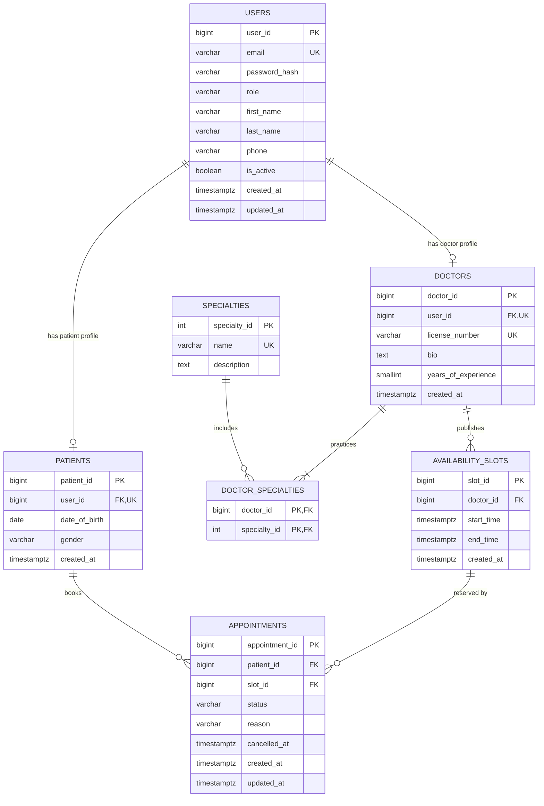

# Database Design & Data Modeling – Scalable Telemedicine Platform

## 1. Overview

This document describes the proposed database design for the Minimum Viable Product (MVP) of the Scalable Telemedicine Platform.

The design targets **PostgreSQL**, as selected in [SOFTWARE_ARCHITECTURE.md](SOFTWARE_ARCHITECTURE.md), and is derived from the functional requirements, user stories, and use cases in [REQUIREMENTS.md](REQUIREMENTS.md).

The document covers:

- Entity Relationship Diagram (ERD)
- Logical and physical schema
- Tables, attributes, and keys
- Normalization

Features outside the MVP scope (video consultations, online payments, and electronic medical records) are intentionally not modeled.

## 2. Design Scope and Requirement Mapping

| Requirement | Supported By |
|---|---|
| FR-01: Patient registration and login | `users`, `patients` |
| FR-02: Browse doctors and specialties | `doctors`, `specialties`, `doctor_specialties` |
| FR-03: Book appointments | `availability_slots`, `appointments` |
| FR-04: Patient views appointments | `appointments` |
| FR-05: Cancel appointments | `appointments.status`, `appointments.cancelled_at` |
| FR-06: Doctor views assigned appointments | `appointments` joined with `availability_slots` |
| FR-07: Persistent data storage | All tables (PostgreSQL) |

## 3. Entity Relationship Diagram (ERD)



### 3.1 Relationship Summary

| Relationship | Cardinality | Description |
|---|---|---|
| USERS – PATIENTS | 1 : 0..1 | A user account has at most one patient profile. |
| USERS – DOCTORS | 1 : 0..1 | A user account has at most one doctor profile. |
| DOCTORS – SPECIALTIES | M : N | A doctor can have several specialties, and a specialty can include many doctors. Resolved through `DOCTOR_SPECIALTIES`. |
| DOCTORS – AVAILABILITY_SLOTS | 1 : N | A doctor publishes many time slots; each slot belongs to one doctor. |
| PATIENTS – APPOINTMENTS | 1 : N | A patient can book many appointments; each appointment belongs to one patient. |
| AVAILABILITY_SLOTS – APPOINTMENTS | 1 : N | A slot can appear in several appointment records over time (for example, after a cancellation), but only **one active** (non-cancelled) appointment is allowed per slot. |

## 4. Logical Schema

The logical schema describes entities, attributes, and relationships independently of a specific DBMS.

Notation: **bold** = primary key, *italic* = foreign key.

- **USERS** (**user_id**, email, password_hash, role, first_name, last_name, phone, is_active, created_at, updated_at)
- **PATIENTS** (**patient_id**, *user_id*, date_of_birth, gender, created_at)
- **DOCTORS** (**doctor_id**, *user_id*, license_number, bio, years_of_experience, created_at)
- **SPECIALTIES** (**specialty_id**, name, description)
- **DOCTOR_SPECIALTIES** (***doctor_id***, ***specialty_id***)
- **AVAILABILITY_SLOTS** (**slot_id**, *doctor_id*, start_time, end_time, created_at)
- **APPOINTMENTS** (**appointment_id**, *patient_id*, *slot_id*, status, reason, cancelled_at, created_at, updated_at)

### 4.1 Business Rules

1. Every user has exactly one role: `patient` or `doctor`.
2. Login data (email, password) is shared by both roles and stored once in `USERS`; role-specific data is stored in `PATIENTS` or `DOCTORS`.
3. Each doctor has at least one specialty (enforced in the application layer).
4. A slot belongs to one doctor, must end after it starts, and a doctor cannot have two slots starting at the same time.
5. A slot can have at most one active (non-cancelled) appointment. This prevents double booking (UC-02).
6. Cancelled appointments are kept for history rather than deleted (UC-08).
7. An appointment's doctor is determined through its slot, so the doctor is not stored again in `APPOINTMENTS`.

## 5. Physical Schema (PostgreSQL)

Target: PostgreSQL 14 or later.

```sql
-- =========================================================
-- Scalable Telemedicine Platform – MVP Schema (PostgreSQL)
-- =========================================================

-- 1. Users: shared authentication data for patients and doctors
CREATE TABLE users (
    user_id        BIGINT GENERATED ALWAYS AS IDENTITY PRIMARY KEY,
    email          VARCHAR(255) NOT NULL,
    password_hash  VARCHAR(255) NOT NULL,
    role           VARCHAR(20)  NOT NULL CHECK (role IN ('patient', 'doctor')),
    first_name     VARCHAR(100) NOT NULL,
    last_name      VARCHAR(100) NOT NULL,
    phone          VARCHAR(20),
    is_active      BOOLEAN      NOT NULL DEFAULT TRUE,
    created_at     TIMESTAMPTZ  NOT NULL DEFAULT NOW(),
    updated_at     TIMESTAMPTZ  NOT NULL DEFAULT NOW()
);

-- Case-insensitive unique email (Ahmed@x.com = ahmed@x.com)
CREATE UNIQUE INDEX ux_users_email ON users (LOWER(email));

-- 2. Patients: patient-specific profile data
CREATE TABLE patients (
    patient_id     BIGINT GENERATED ALWAYS AS IDENTITY PRIMARY KEY,
    user_id        BIGINT NOT NULL UNIQUE
                   REFERENCES users (user_id) ON DELETE CASCADE,
    date_of_birth  DATE,
    gender         VARCHAR(10) CHECK (gender IN ('male', 'female')),
    created_at     TIMESTAMPTZ NOT NULL DEFAULT NOW()
);

-- 3. Doctors: doctor-specific profile data
CREATE TABLE doctors (
    doctor_id            BIGINT GENERATED ALWAYS AS IDENTITY PRIMARY KEY,
    user_id              BIGINT NOT NULL UNIQUE
                         REFERENCES users (user_id) ON DELETE CASCADE,
    license_number       VARCHAR(50) NOT NULL UNIQUE,
    bio                  TEXT,
    years_of_experience  SMALLINT CHECK (years_of_experience >= 0),
    created_at           TIMESTAMPTZ NOT NULL DEFAULT NOW()
);

-- 4. Specialties: lookup table
CREATE TABLE specialties (
    specialty_id   INT GENERATED ALWAYS AS IDENTITY PRIMARY KEY,
    name           VARCHAR(100) NOT NULL UNIQUE,
    description    TEXT
);

-- 5. Doctor_Specialties: junction table for the M:N relationship
CREATE TABLE doctor_specialties (
    doctor_id      BIGINT NOT NULL
                   REFERENCES doctors (doctor_id) ON DELETE CASCADE,
    specialty_id   INT    NOT NULL
                   REFERENCES specialties (specialty_id) ON DELETE RESTRICT,
    PRIMARY KEY (doctor_id, specialty_id)
);

-- Supports "browse doctors by specialty" (FR-02)
CREATE INDEX ix_doctor_specialties_specialty ON doctor_specialties (specialty_id);

-- 6. Availability slots published by doctors
CREATE TABLE availability_slots (
    slot_id        BIGINT GENERATED ALWAYS AS IDENTITY PRIMARY KEY,
    doctor_id      BIGINT NOT NULL
                   REFERENCES doctors (doctor_id) ON DELETE RESTRICT,
    start_time     TIMESTAMPTZ NOT NULL,
    end_time       TIMESTAMPTZ NOT NULL,
    created_at     TIMESTAMPTZ NOT NULL DEFAULT NOW(),
    CONSTRAINT chk_slot_time_order CHECK (end_time > start_time),
    CONSTRAINT uq_doctor_slot_start UNIQUE (doctor_id, start_time)
);

-- 7. Appointments
CREATE TABLE appointments (
    appointment_id  BIGINT GENERATED ALWAYS AS IDENTITY PRIMARY KEY,
    patient_id      BIGINT NOT NULL
                    REFERENCES patients (patient_id) ON DELETE RESTRICT,
    slot_id         BIGINT NOT NULL
                    REFERENCES availability_slots (slot_id) ON DELETE RESTRICT,
    status          VARCHAR(20) NOT NULL DEFAULT 'booked'
                    CHECK (status IN ('booked', 'cancelled', 'completed')),
    reason          VARCHAR(500),
    cancelled_at    TIMESTAMPTZ,
    created_at      TIMESTAMPTZ NOT NULL DEFAULT NOW(),
    updated_at      TIMESTAMPTZ NOT NULL DEFAULT NOW(),
    -- cancelled_at is set only when the appointment is cancelled
    CONSTRAINT chk_cancelled_at
        CHECK ((status = 'cancelled') = (cancelled_at IS NOT NULL))
);

-- Prevents double booking: only one non-cancelled appointment per slot.
-- A cancelled slot can be booked again.
CREATE UNIQUE INDEX ux_appointments_active_slot
    ON appointments (slot_id)
    WHERE status <> 'cancelled';

-- Supports "patient views appointments" (FR-04)
CREATE INDEX ix_appointments_patient ON appointments (patient_id);
```

### 5.1 Physical Design Decisions

| Decision | Reason |
|---|---|
| `BIGINT GENERATED ALWAYS AS IDENTITY` primary keys | Standard SQL auto-increment; avoids exposing business data in keys. |
| `TIMESTAMPTZ` for all date-times | Stores times with time zone awareness, avoiding errors between server and user time zones. |
| `password_hash` instead of password | Passwords are stored only as hashes (for example, bcrypt or Argon2) to support NFR-04. |
| `CHECK` constraints for `role`, `status`, `gender` | Restricts columns to valid values; easier to change in migrations than PostgreSQL `ENUM` types. |
| `ON DELETE RESTRICT` for appointments | Prevents deleting doctors, patients, or slots that still have appointment history. Accounts are deactivated with `users.is_active` instead. |
| Partial unique index on active slot bookings | Enforces "one active booking per slot" at database level, which stays correct even when several backend instances run in Kubernetes. |

### 5.2 Key Queries

**Available slots for a doctor (UC-02, step 3):**

```sql
SELECT s.slot_id, s.start_time, s.end_time
FROM availability_slots s
WHERE s.doctor_id = $1
  AND s.start_time > NOW()
  AND NOT EXISTS (
      SELECT 1 FROM appointments a
      WHERE a.slot_id = s.slot_id
        AND a.status <> 'cancelled'
  )
ORDER BY s.start_time;
```

**Book an appointment (UC-02, steps 5–6):**

```sql
INSERT INTO appointments (patient_id, slot_id, reason)
VALUES ($1, $2, $3);
-- If the slot was booked meanwhile, ux_appointments_active_slot rejects the insert.
-- The backend returns "slot no longer available" (UC-02 alternative flow).
```

**Cancel an appointment (UC-08):**

```sql
UPDATE appointments
SET status = 'cancelled', cancelled_at = NOW(), updated_at = NOW()
WHERE appointment_id = $1
  AND patient_id = $2          -- patients can cancel only their own appointments
  AND status = 'booked';
```

**Doctor's assigned appointments (UC-03):**

```sql
SELECT a.appointment_id, s.start_time, s.end_time, a.status,
       u.first_name AS patient_first_name, u.last_name AS patient_last_name
FROM appointments a
JOIN availability_slots s ON s.slot_id = a.slot_id
JOIN patients p           ON p.patient_id = a.patient_id
JOIN users u              ON u.user_id = p.user_id
WHERE s.doctor_id = $1
ORDER BY s.start_time;
```

## 6. Tables, Attributes, and Keys

### 6.1 Data Dictionary

**users**

| Attribute | Type | Constraints | Description |
|---|---|---|---|
| user_id | BIGINT | PK | Unique user identifier. |
| email | VARCHAR(255) | NOT NULL, UNIQUE (case-insensitive) | Login identifier. |
| password_hash | VARCHAR(255) | NOT NULL | Hashed password. |
| role | VARCHAR(20) | NOT NULL, CHECK | `patient` or `doctor`. |
| first_name | VARCHAR(100) | NOT NULL | User's first name. |
| last_name | VARCHAR(100) | NOT NULL | User's last name. |
| phone | VARCHAR(20) | NULL | Contact number. |
| is_active | BOOLEAN | NOT NULL, DEFAULT TRUE | Used to deactivate accounts instead of deleting them. |
| created_at / updated_at | TIMESTAMPTZ | NOT NULL | Audit timestamps. |

**patients**

| Attribute | Type | Constraints | Description |
|---|---|---|---|
| patient_id | BIGINT | PK | Unique patient identifier. |
| user_id | BIGINT | FK → users, UNIQUE, NOT NULL | Linked user account (1:1). |
| date_of_birth | DATE | NULL | Patient's date of birth. |
| gender | VARCHAR(10) | NULL, CHECK | `male` or `female`. |
| created_at | TIMESTAMPTZ | NOT NULL | Creation timestamp. |

**doctors**

| Attribute | Type | Constraints | Description |
|---|---|---|---|
| doctor_id | BIGINT | PK | Unique doctor identifier. |
| user_id | BIGINT | FK → users, UNIQUE, NOT NULL | Linked user account (1:1). |
| license_number | VARCHAR(50) | NOT NULL, UNIQUE | Medical license number. |
| bio | TEXT | NULL | Professional profile text. |
| years_of_experience | SMALLINT | NULL, CHECK ≥ 0 | Years of practice. |
| created_at | TIMESTAMPTZ | NOT NULL | Creation timestamp. |

**specialties**

| Attribute | Type | Constraints | Description |
|---|---|---|---|
| specialty_id | INT | PK | Unique specialty identifier. |
| name | VARCHAR(100) | NOT NULL, UNIQUE | Specialty name (for example, Cardiology). |
| description | TEXT | NULL | Short description. |

**doctor_specialties**

| Attribute | Type | Constraints | Description |
|---|---|---|---|
| doctor_id | BIGINT | PK (composite), FK → doctors | Doctor. |
| specialty_id | INT | PK (composite), FK → specialties | Specialty. |

**availability_slots**

| Attribute | Type | Constraints | Description |
|---|---|---|---|
| slot_id | BIGINT | PK | Unique slot identifier. |
| doctor_id | BIGINT | FK → doctors, NOT NULL | Slot owner. |
| start_time | TIMESTAMPTZ | NOT NULL, UNIQUE with doctor_id | Slot start. |
| end_time | TIMESTAMPTZ | NOT NULL, CHECK > start_time | Slot end. |
| created_at | TIMESTAMPTZ | NOT NULL | Creation timestamp. |

**appointments**

| Attribute | Type | Constraints | Description |
|---|---|---|---|
| appointment_id | BIGINT | PK | Unique appointment identifier. |
| patient_id | BIGINT | FK → patients, NOT NULL | Patient who booked. |
| slot_id | BIGINT | FK → availability_slots, NOT NULL | Booked slot (also identifies the doctor). |
| status | VARCHAR(20) | NOT NULL, CHECK, DEFAULT `booked` | `booked`, `cancelled`, or `completed`. |
| reason | VARCHAR(500) | NULL | Optional reason for visit. |
| cancelled_at | TIMESTAMPTZ | Set only when cancelled | Cancellation time. |
| created_at / updated_at | TIMESTAMPTZ | NOT NULL | Audit timestamps. |

### 6.2 Keys Summary

| Table | Primary Key | Foreign Keys | Candidate / Unique Keys |
|---|---|---|---|
| users | user_id | – | email |
| patients | patient_id | user_id → users | user_id |
| doctors | doctor_id | user_id → users | user_id, license_number |
| specialties | specialty_id | – | name |
| doctor_specialties | (doctor_id, specialty_id) | doctor_id → doctors, specialty_id → specialties | – |
| availability_slots | slot_id | doctor_id → doctors | (doctor_id, start_time) |
| appointments | appointment_id | patient_id → patients, slot_id → availability_slots | slot_id where status ≠ `cancelled` (partial) |

**Key types used:**

- **Primary keys:** surrogate identity columns, except `doctor_specialties`, which uses a **composite primary key**.
- **Foreign keys:** enforce referential integrity between related tables.
- **Candidate keys:** attributes that could also uniquely identify a row (for example, `email`, `license_number`) and are enforced with `UNIQUE` constraints.
- **Partial unique key:** enforces a uniqueness rule only for active appointments.

## 7. Normalization

This section shows how the schema was derived by normalizing a single unstructured booking table up to Third Normal Form (3NF).

### 7.1 Unnormalized Form (UNF)

A naive design stores everything in one table:

| appointment_id | patient_name | patient_email | doctor_name | doctor_specialties | slot_time | status |
|---|---|---|---|---|---|---|
| 1 | Ahmed Ali | ahmed@example.com | Dr. Sara Hassan | Cardiology, Internal Medicine | 2026-11-03 10:00 | booked |
| 2 | Mona Adel | mona@example.com | Dr. Sara Hassan | Cardiology, Internal Medicine | 2026-11-03 10:30 | booked |
| 3 | Ahmed Ali | ahmed@example.com | Dr. Omar Nabil | Dermatology | 2026-11-04 12:00 | cancelled |

**Problems:**

- **Repeating group:** `doctor_specialties` holds multiple values in one cell.
- **Update anomaly:** changing Dr. Sara's name requires updating every row of her appointments.
- **Insertion anomaly:** a new doctor cannot be added until someone books an appointment with them.
- **Deletion anomaly:** deleting Mona's only appointment also deletes all information about Mona.

### 7.2 First Normal Form (1NF)

**Rule:** every cell holds one atomic value, and there are no repeating groups.

The specialties are split into one value per row. The key becomes `(appointment_id, specialty)`:

| appointment_id | specialty | patient_name | patient_email | doctor_name | slot_time | status |
|---|---|---|---|---|---|---|
| 1 | Cardiology | Ahmed Ali | ahmed@example.com | Dr. Sara Hassan | 2026-11-03 10:00 | booked |
| 1 | Internal Medicine | Ahmed Ali | ahmed@example.com | Dr. Sara Hassan | 2026-11-03 10:00 | booked |
| 2 | Cardiology | Mona Adel | mona@example.com | Dr. Sara Hassan | 2026-11-03 10:30 | booked |
| ... | ... | ... | ... | ... | ... | ... |

The table is now in 1NF, but redundancy has increased.

### 7.3 Second Normal Form (2NF)

**Rule:** the table is in 1NF and no non-key attribute depends on only part of a composite key.

With the key `(appointment_id, specialty)`, attributes such as `patient_name` and `slot_time` depend only on `appointment_id`, and the specialty depends on the doctor, not on the appointment. These are **partial dependencies**.

The table is decomposed (a `doctor_id` is introduced to identify doctors):

- **APPOINTMENTS** (**appointment_id**, patient_email, patient_name, doctor_id, doctor_name, slot_time, status)
- **DOCTOR_SPECIALTIES** (**doctor_id**, **specialty_name**)

### 7.4 Third Normal Form (3NF)

**Rule:** the table is in 2NF and no non-key attribute depends on another non-key attribute (no **transitive dependencies**).

The remaining transitive dependencies in `APPOINTMENTS` are:

| Transitive Dependency | Resolution |
|---|---|
| appointment_id → patient_email → patient_name | Move patient data to `USERS` / `PATIENTS`; reference by `patient_id`. |
| appointment_id → doctor_id → doctor_name | Move doctor data to `USERS` / `DOCTORS`; reference by `doctor_id`. |
| appointment_id → slot → doctor_id | Move time slots to `AVAILABILITY_SLOTS`; reference by `slot_id`. `doctor_id` is removed from appointments because it is determined by the slot. |
| specialty_name repeated across doctors | Move to `SPECIALTIES`; reference by `specialty_id`. |

In addition, login attributes common to both roles (email, password, name) are stored once in `USERS` (a generalization design decision), and role-specific attributes remain in `PATIENTS` and `DOCTORS`.

### 7.5 Final Result

| Table | 1NF | 2NF | 3NF |
|---|---|---|---|
| users | ✓ | ✓ | ✓ |
| patients | ✓ | ✓ | ✓ |
| doctors | ✓ | ✓ | ✓ |
| specialties | ✓ | ✓ | ✓ |
| doctor_specialties | ✓ | ✓ | ✓ |
| availability_slots | ✓ | ✓ | ✓ |
| appointments | ✓ | ✓ | ✓ |

In every table, each determinant is a candidate key, so the schema also satisfies **Boyce–Codd Normal Form (BCNF)**.

All four anomalies from Section 7.1 are resolved: doctor and patient data are stored once, doctors can exist without appointments, and deleting an appointment does not delete patient data.

### 7.6 Derived Data (Intentionally Not Stored)

- **Slot availability** is not stored as an `is_booked` flag. It is derived from whether an active appointment exists, which avoids the flag and the appointments disagreeing.
- **The appointment's doctor** is not stored in `appointments`. It is derived through `slot_id`.

If performance testing later shows a need, frequently read data (for example, doctor lists per specialty) should first be cached in Redis before considering denormalization.

## 8. Redis Usage

Redis is not a source of truth and does not appear in the ERD. All persistent data is stored in PostgreSQL. Possible Redis uses include caching the doctor list per specialty and storing short-lived session or token data, subject to implementation decisions.

## 9. Data Security Considerations

- Passwords are stored only as hashes.
- Only fake or seeded test data is used; no real patient data (see Section 4.2 of [PROJECT_PROPOSAL.md](PROJECT_PROPOSAL.md)).
- The backend connects with a dedicated database user with only the privileges it needs.
- Database credentials are provided through environment variables or Kubernetes Secrets and are never committed to the repository.

## 10. Current Status

This document describes the proposed database design for the MVP. It has not yet been implemented or validated.

If the selected base application includes its own database schema, this design will be compared with it and updated before implementation.
