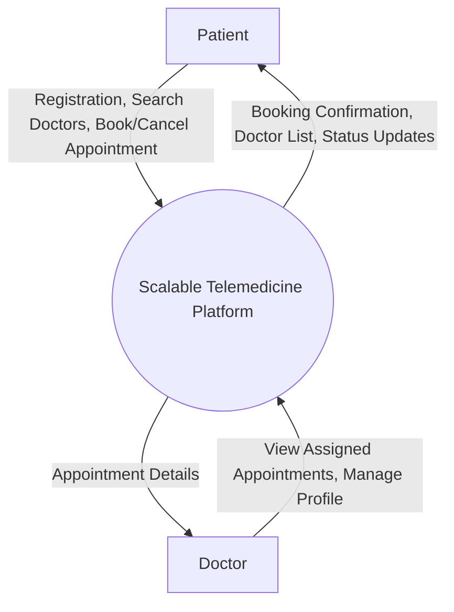
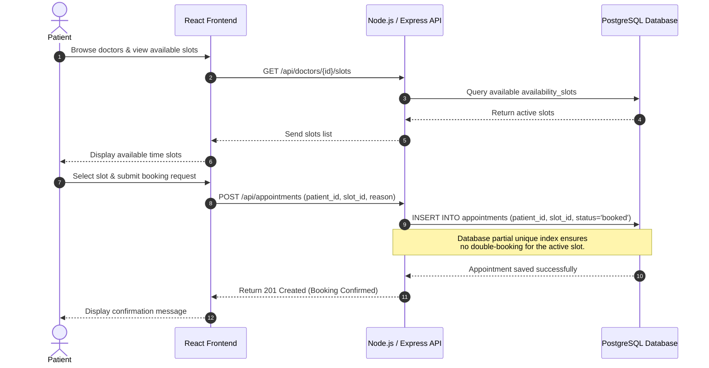
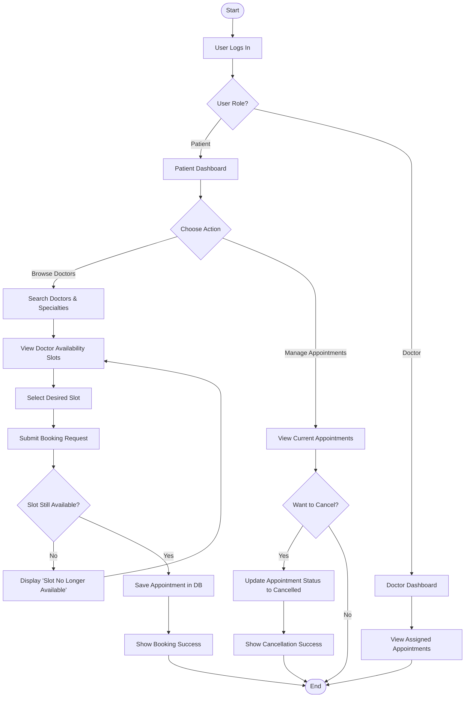
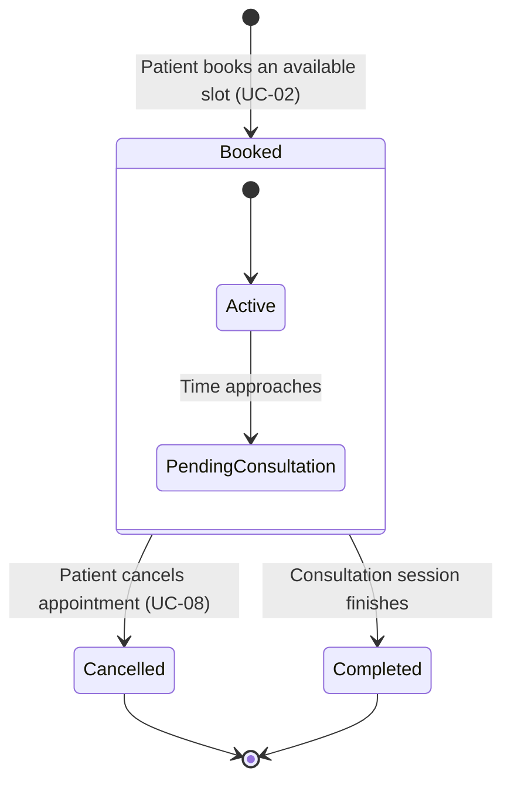
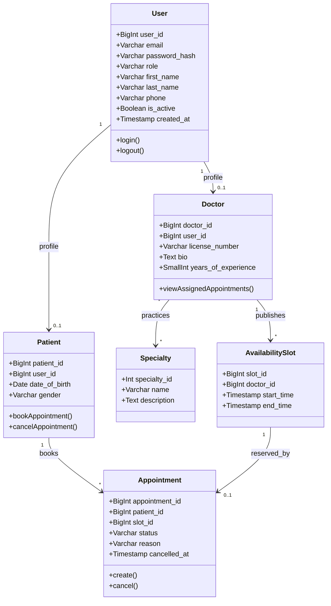

# Data Flow and System Behavior - Scalable Telemedicine Platform

## 1. Data Flow Diagrams (DFD)

### 1.1. Context-Level DFD (Level 0)

### 1.2. Level 1 DFD

graph TD
    subgraph ext["External Entities"]
        P["Patient"]
        D["Doctor"]
    end

    subgraph proc["System Processes"]
        P1["1.0 User Authentication"]
        P2["2.0 Doctor Search and Browse"]
        P3["3.0 Appointment Management"]
    end

    subgraph store["Data Stores"]
        DS1[("Users and Profiles DB")]
        DS2[("Doctors and Specialties DB")]
        DS3[("Availability Slots DB")]
        DS4[("Appointments DB")]
    end

    P -->|"Registration / Login credentials"| P1
    D -->|"Login credentials"| P1
    P1 <-->|"Read / Create / Update user data"| DS1
    P1 -->|"Authentication result"| P
    P1 -->|"Authentication result"| D

    P -->|"Search criteria / Specialty"| P2
    P2 -->|"Query doctor profiles and specialties"| DS2
    DS2 -->|"Doctor profiles and specialties"| P2
    P2 -->|"Query available slots"| DS3
    DS3 -->|"Available slots"| P2
    P2 -->|"Doctor list and availability"| P

    P -->|"Book / Cancel appointment request"| P3
    D -->|"View assigned appointments request"| P3
    P3 <-->|"Check / Update slot availability"| DS3
    P3 <-->|"Create / Read / Update appointment"| DS4
    P3 -->|"Booking / Cancellation status"| P
    P3 -->|"Assigned appointment details"| D

## 2. Sequence Diagram - Booking an Appointment

## 3. User Flow (Flowchart)

## 4. Appointment State Diagram

## 5. Class Diagram

