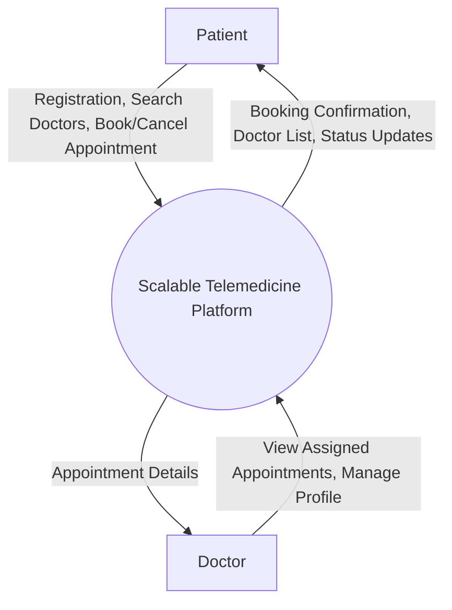
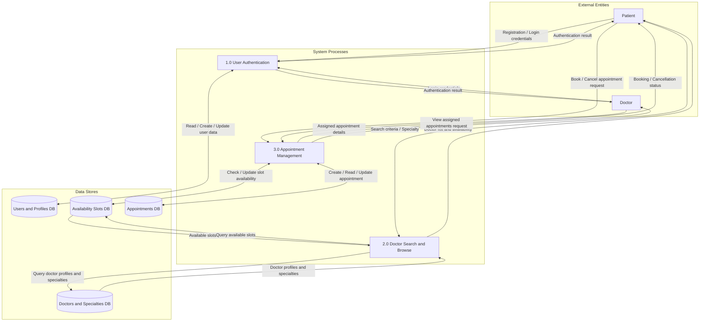
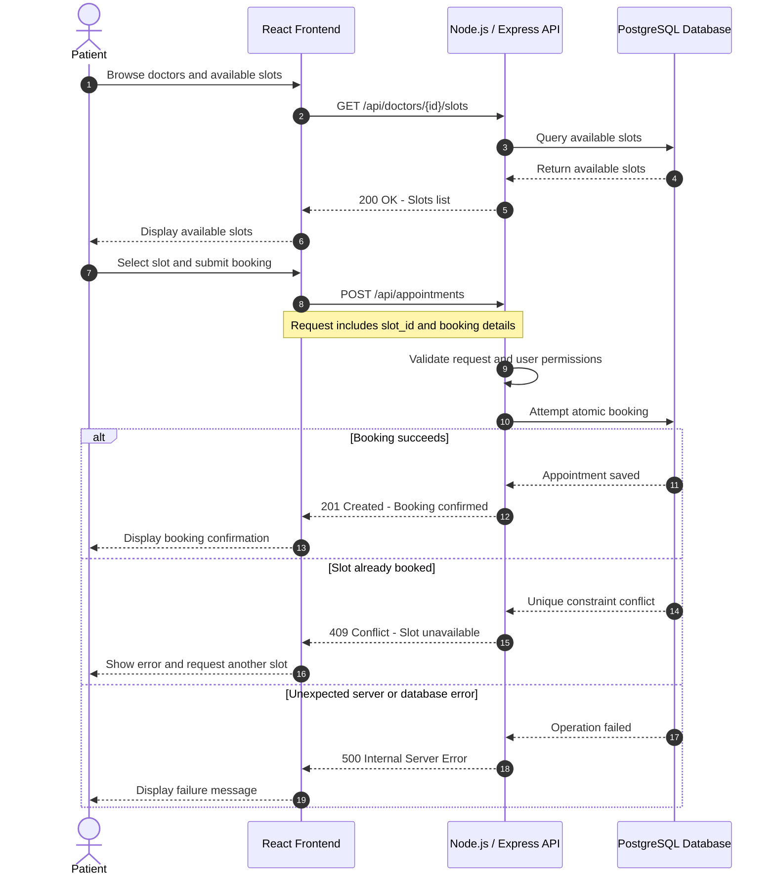
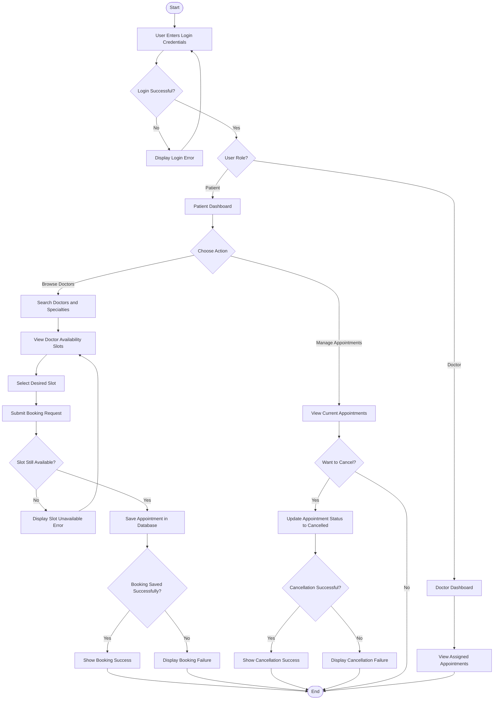
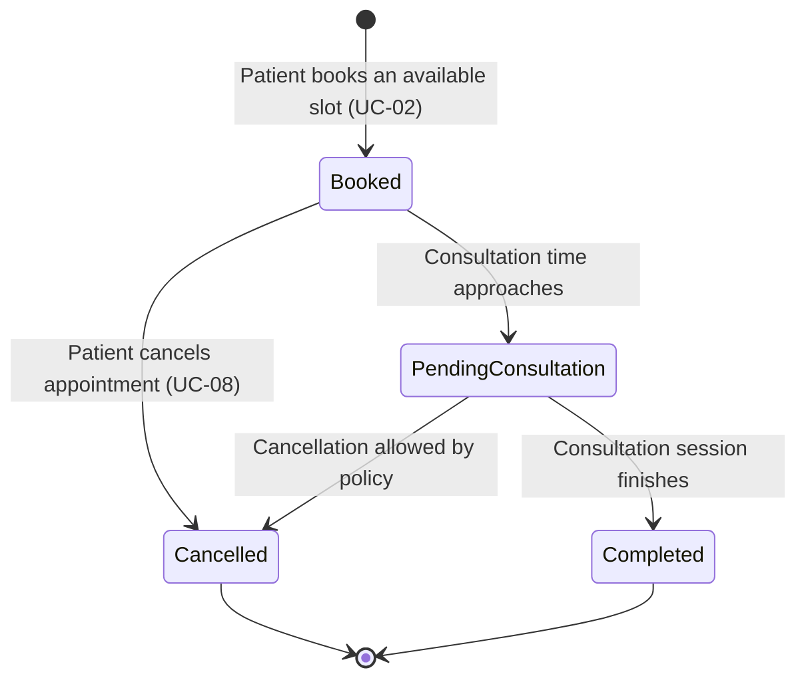
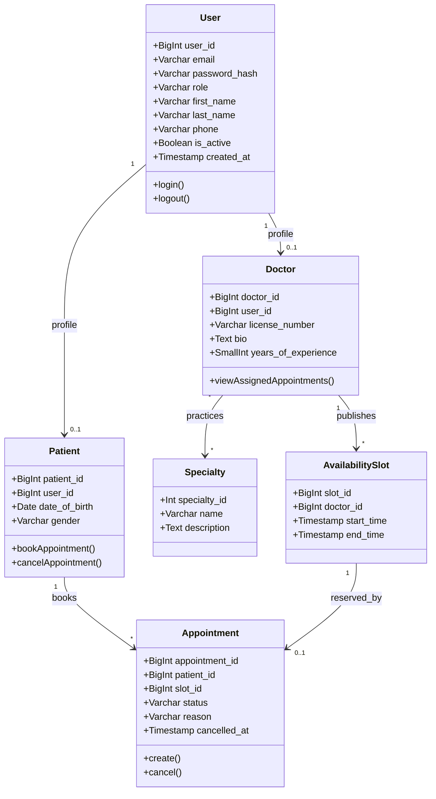

# Data Flow and System Behavior - Scalable Telemedicine Platform

## 1. Data Flow Diagrams (DFD)

### 1.1. Context-Level DFD (Level 0)

### 1.2. Level 1 DFD

## 2. Sequence Diagram - Booking an Appointment

## 3. User Flow (Flowchart)

## 4. Appointment State Diagram

## 5. Class Diagram

