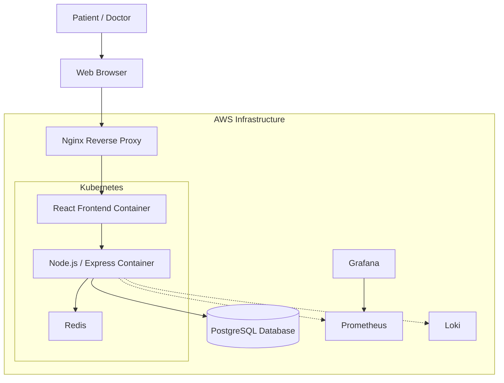
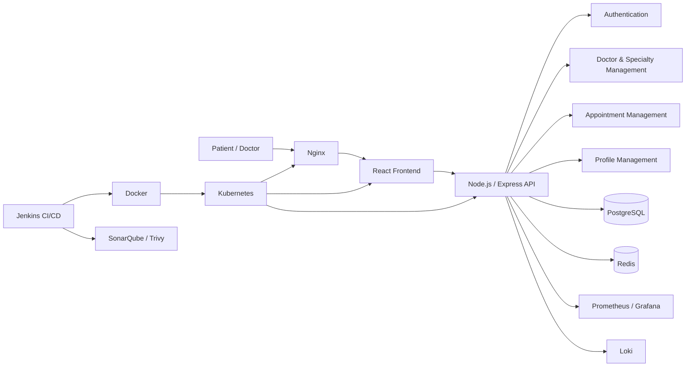

# System Deployment & Integration

Telemedicine Appointment Platform: deployment, DevOps tooling and integration documentation.

## Table of Contents

- [5. System Deployment & Integration](#5-system-deployment--integration)
  - [5.1 Technology Stack](#51-technology-stack)
  - [5.2 Deployment Diagram](#52-deployment-diagram)
  - [5.3 Component Diagram](#53-component-diagram)
- [6. Additional Deliverables](#6-additional-deliverables)
  - [6.1 API Documentation](#61-api-documentation)
  - [6.2 Testing & Validation Plan](#62-testing--validation-plan)
  - [6.3 Deployment Strategy](#63-deployment-strategy)
  - [6.4 Deployment Validation Checklist](#64-deployment-validation-checklist)
  - [6.5 Rollback & Recovery Strategy](#65-rollback--recovery-strategy)
  - [6.6 Final Integration Flow](#66-final-integration-flow)

---

# 5. System Deployment & Integration

## 5.1 Technology Stack

### Application Layer

- **Frontend:** React
- **Backend:** Node.js / Express
- **Database:** PostgreSQL
- **Cache:** Redis

### DevOps & Infrastructure

- **Version Control:** Git / GitHub
- **CI/CD:** Jenkins
- **Containerization:** Docker / Docker Compose
- **Configuration Management:** Ansible
- **Container Orchestration:** Kubernetes
- **Reverse Proxy:** Nginx
- **Infrastructure as Code:** Terraform
- **Cloud Platform:** AWS

### Security & Code Quality

- **SonarQube:** Code quality analysis
- **Trivy:** Container and artifact security scanning

### Monitoring & Logging

- **Prometheus:** Metrics collection
- **Grafana:** Monitoring dashboards
- **Loki:** Centralized log collection

The selected stack follows the proposed project architecture. React handles the user interface, Node.js/Express provides the API and business logic, PostgreSQL provides persistent storage, while Docker, Kubernetes, Nginx, Terraform and AWS support deployment and infrastructure management.

---

## 5.2 Deployment Diagram



### Deployment Flow

1. The developer pushes code to GitHub.
2. Jenkins detects the change and starts the CI/CD pipeline.
3. The application is validated and security/code-quality checks are executed.
4. Docker builds the required application images.
5. Kubernetes deploys the containerized application.
6. Nginx receives incoming requests and routes them to the appropriate application service.
7. Node.js/Express communicates with PostgreSQL and Redis.
8. Prometheus collects metrics while Grafana provides dashboards.
9. Loki collects application logs.

The architecture documentation defines the same main flow: browser → Nginx → React → Node.js/Express → PostgreSQL/Redis, with Kubernetes and AWS supporting the deployment environment.

---

## 5.3 Component Diagram



### Component Responsibilities

| Component | Responsibility |
|---|---|
| React Frontend | User interface for patients and doctors |
| Node.js / Express API | API endpoints, authentication, validation and business logic |
| Authentication | User registration and login |
| Doctor Management | Doctors, specialties and availability |
| Appointment Management | Booking, viewing and cancellation |
| Profile Management | Patient and doctor profile operations |
| PostgreSQL | Persistent application data |
| Redis | Caching or temporary data |
| Nginx | Reverse proxy and request routing |
| Jenkins | CI/CD automation |
| Docker | Container packaging |
| Kubernetes | Container orchestration and scaling |
| Terraform | Infrastructure as Code |
| Ansible | Configuration management and automation |
| SonarQube | Code quality analysis |
| Trivy | Security scanning |
| Prometheus | Metrics collection |
| Grafana | Metrics visualization |
| Loki | Log collection and analysis |

The component responsibilities are based on the existing Software Architecture document.

---

# 6. Additional Deliverables

## 6.1 API Documentation

The backend API is implemented/planned using Node.js and Express. The API provides authentication, doctor browsing, profile management and appointment management.

### Authentication

| Method | Endpoint | Purpose |
|---|---|---|
| POST | `/auth/register` | Register a new patient |
| POST | `/auth/login` | Authenticate a patient or doctor |

### Doctors

| Method | Endpoint | Purpose |
|---|---|---|
| GET | `/doctors` | Retrieve available doctors |
| GET | `/doctors/:id` | Retrieve doctor information |
| GET | `/specialties` | Retrieve available specialties |
| GET | `/doctors/:id/availability` | Retrieve available appointment slots |

### Appointments

| Method | Endpoint | Purpose |
|---|---|---|
| POST | `/appointments` | Create an appointment |
| GET | `/appointments` | Retrieve patient's appointments |
| PATCH | `/appointments/:id/cancel` | Cancel an appointment |
| GET | `/doctor/appointments` | Retrieve appointments assigned to a doctor |

### Profiles

| Method | Endpoint | Purpose |
|---|---|---|
| GET | `/profile` | Retrieve the authenticated user's profile |
| PUT | `/profile` | Update the authenticated user's profile |

### Booking API Example

```http
POST /appointments
Content-Type: application/json
Authorization: Bearer <token>

{
  "slot_id": 101,
  "reason": "General consultation"
}
```

Possible responses:

| Status | Meaning |
|---|---|
| `201 Created` | Appointment successfully created |
| `400 Bad Request` | Invalid request data |
| `401 Unauthorized` | User is not authenticated |
| `409 Conflict` | Selected slot is no longer available |
| `500 Internal Server Error` | Unexpected database or server error |

The booking flow is defined in the project data-flow documentation: the frontend sends `POST /appointments`, the API authenticates and validates the request, then PostgreSQL verifies the slot and creates the appointment. A database constraint prevents multiple active appointments for the same slot.

---

## 6.2 Testing & Validation Plan

Testing will verify both the functional requirements and the DevOps deployment requirements.

### Functional Testing

| Test Area | Validation |
|---|---|
| Registration | Patient can create an account |
| Login | Patient/Doctor can authenticate successfully |
| Doctor Search | Patient can browse doctors and specialties |
| Availability | Available appointment slots are displayed |
| Booking | Patient can book an available slot |
| Double Booking | System rejects an already booked active slot |
| Appointment Viewing | Patient can view appointments |
| Cancellation | Patient can cancel an eligible appointment |
| Doctor Appointments | Doctor can view assigned appointments |

These tests directly correspond to the defined functional requirements and acceptance criteria.

### Integration Testing

The following integrations should be tested:

```text
React
   ↓
Node.js / Express
   ↓
PostgreSQL
   ↓
Redis

Jenkins
   ↓
Docker
   ↓
Kubernetes
   ↓
AWS

Prometheus → Grafana
Loki → Log Analysis
SonarQube / Trivy → Security & Quality Checks
```

### Security Validation

- Run SonarQube code-quality analysis.
- Run Trivy security scans.
- Verify that passwords are stored as hashes.
- Verify authentication and authorization.
- Verify that secrets are not stored in source control.
- Review security findings before release.

The project risk assessment specifically identifies dependency/container vulnerabilities and recommends security scanning and avoiding secrets in source control.

### Performance & Monitoring Validation

The initial KPI targets include:

- At least **90% deployment success rate**
- **95% of tested requests within 2 seconds** under the agreed workload
- At least **99% service availability** during the agreed test period
- At least **90% automated test pass rate**
- **Zero unresolved critical security findings**
- **100% monitoring coverage** for identified core services

These are proposed targets and must be validated using actual measurements during implementation and testing.

---

## 6.3 Deployment Strategy

The deployment strategy follows a staged DevOps workflow.

### Phase 1: Source Control

```text
Developer
   ↓
Git
   ↓
GitHub Repository
```

Code and configuration are maintained using Git and GitHub.

### Phase 2: Continuous Integration

```text
GitHub
   ↓
Jenkins
   ↓
Build
   ↓
Tests
   ↓
SonarQube
   ↓
Trivy
```

Jenkins automates the planned build and validation process, while SonarQube and Trivy provide code-quality and security checks.

### Phase 3: Containerization

```text
Application Source
        ↓
Docker Build
        ↓
Docker Image
        ↓
Container Registry / Deployment
```

The application components are packaged into Docker containers before deployment.

### Phase 4: Infrastructure Deployment

```text
Terraform
    ↓
AWS Infrastructure
    ↓
Kubernetes
    ↓
Application Containers
```

Terraform is used as the Infrastructure-as-Code layer, while Kubernetes manages the container workloads.

### Phase 5: Traffic Management

```text
Internet
   ↓
Nginx
   ↓
React / Node.js
   ↓
PostgreSQL / Redis
```

Nginx acts as the reverse proxy and routes incoming traffic to the appropriate services.

### Phase 6: Monitoring and Logging

```text
Application / Infrastructure
          ↓
     Prometheus
          ↓
       Grafana

Application Logs
       ↓
      Loki
```

Prometheus and Grafana provide metrics and dashboards, while Loki provides centralized log collection.

---

## 6.4 Deployment Validation Checklist

Before considering the deployment successful, verify:

- [ ] Application containers start successfully.
- [ ] Frontend can communicate with the backend.
- [ ] Backend can connect to PostgreSQL.
- [ ] Redis is available when required.
- [ ] Nginx routes requests correctly.
- [ ] Kubernetes workloads are running correctly.
- [ ] CI/CD pipeline completes the required stages.
- [ ] SonarQube analysis completes.
- [ ] Trivy scan completes with no unresolved critical findings.
- [ ] Prometheus receives metrics.
- [ ] Grafana dashboards are accessible.
- [ ] Loki receives application logs.
- [ ] Registration and login work.
- [ ] Doctor browsing works.
- [ ] Appointment booking works.
- [ ] Appointment cancellation works.
- [ ] Doctor appointment viewing works.

The project acceptance criteria require successful core application functionality, persistent data, deployment using the planned infrastructure, and basic monitoring/logging availability.

---

## 6.5 Rollback & Recovery Strategy

If a deployment fails:

1. Identify the failed CI/CD or deployment stage.
2. Review Jenkins, application, Kubernetes and infrastructure logs.
3. Stop or isolate the failed deployment where necessary.
4. Roll back to the last known working version.
5. Verify application health.
6. Re-run the required tests.
7. Fix the root cause.
8. Deploy the corrected version.

This approach is consistent with the project's risk mitigation plan, which recommends reviewing logs and rolling back to a known working version where possible after pipeline or deployment failures.

---

## 6.6 Final Integration Flow

```text
                    GitHub
                       |
                       v
                   Jenkins
                       |
          +------------+------------+
          |                         |
          v                         v
      SonarQube                   Trivy
          |                         |
          +------------+------------+
                       |
                       v
                    Docker
                       |
                       v
                 Kubernetes
                       |
                       v
                    AWS
                       |
                       v
                    Nginx
                       |
                +------+------+
                |             |
                v             v
             React       Node.js/Express
                              |
                       +------+------+
                       |             |
                       v             v
                  PostgreSQL       Redis
                       |
                 Application
                  Monitoring
                       |
              +--------+--------+
              |                 |
              v                 v
          Prometheus           Loki
              |
              v
           Grafana
```

### Expected Final Outcome

The final deployment should provide a repeatable workflow for building, validating, containerizing, deploying, monitoring and maintaining the telemedicine application. The project documentation currently describes these components as **planned/proposed**, so they should only be marked as implemented after the corresponding configuration and testing evidence has been completed.
