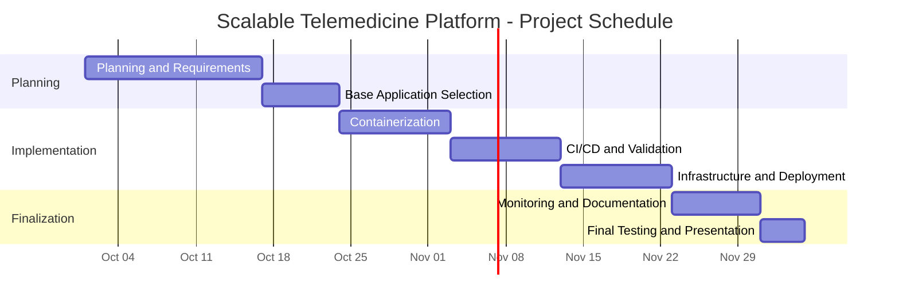

# Project Plan

## 1. Project Summary

The Scalable Telemedicine Platform project focuses on preparing and deploying a web application using DevOps practices, containerization, CI/CD, cloud infrastructure, security checks, and monitoring.

This plan defines the proposed project phases, milestones, deliverables, and team responsibilities.

## 2. Project Timeline

The following dates represent a proposed baseline for team review. They must be confirmed against the official DEPI schedule and updated according to actual progress.

| Phase | Planned Start | Planned End | Main Deliverable |
|---|---|---|---|
| 1. Planning and Requirements | October 1, 2026 | October 16, 2026 | Planning and requirements documentation |
| 2. Base Application Selection | October 17, 2026 | October 23, 2026 | Selected application and license review |
| 3. Containerization | October 24, 2026 | November 2, 2026 | Dockerfiles and Docker Compose configuration |
| 4. CI/CD and Validation | November 3, 2026 | November 12, 2026 | Automated pipeline and validation checks |
| 5. Infrastructure and Deployment | November 13, 2026 | November 22, 2026 | Infrastructure configuration and deployment |
| 6. Monitoring and Documentation | November 23, 2026 | November 30, 2026 | Monitoring dashboards, logs, and deployment documentation |
| 7. Final Testing and Presentation | December 1, 2026 | December 4, 2026 | Test results, final report, and presentation |

## 3. Gantt Chart

## 4. Project Milestones

| Milestone | Completion Evidence |
|---|---|
| M1: Planning Approved | Project scope, requirements, risks, KPIs, and project plan reviewed by the team |
| M2: Base Application Selected | A suitable application is selected, runs locally, and its license is reviewed |
| M3: Application Containerized | Required application containers start and communicate successfully |
| M4: CI/CD Configured | The pipeline executes the agreed build and validation stages successfully |
| M5: Infrastructure Deployed | The application is deployed to the selected target environment |
| M6: Monitoring Configured | Core service metrics, dashboards, and logs are accessible |
| M7: Final Review Completed | Testing evidence, final documentation, and presentation materials are prepared |

## 5. Team Responsibilities

| Team Member | Primary Responsibility |
|---|---|
| Ziad | Docker and Ansible |
| Felopateer | Kubernetes and Nginx |
| Hisham | Jenkins and Git |
| Mohamed | Terraform and AWS |
| Omar | Prometheus and Grafana |

Responsibilities may overlap during integration, troubleshooting, and testing. Team members should coordinate shared changes and review configurations before merging them.

## 6. Deliverables

The planned project deliverables include:

- Project planning and requirements documentation.
- Selected base application and license review.
- Dockerfiles and Docker Compose configuration.
- CI/CD pipeline configuration and validation results.
- Infrastructure as Code and deployment configuration.
- Security and code-quality scan results.
- Monitoring dashboards and centralized application logs.
- Test results, deployment instructions, and final project documentation.
- Final project presentation.

These deliverables describe expected outputs; they should only be marked complete after the relevant work and verification are finished.

## 7. Progress Tracking

Project tasks will be tracked through GitHub Issues and the GitHub Projects board.

- New tasks should be recorded as GitHub Issues.
- Tasks should move to In Progress when work begins.
- Tasks should move to Done after their acceptance criteria have been verified.
- Project documentation and milestone status should be updated as the project progresses.

## 8. Schedule Assumptions and Constraints

- The dates in the timeline and Gantt chart are proposed planning dates, not evidence of completed work.
- The schedule depends on selecting a suitable base application and resolving integration issues.
- The team should revise the schedule if dependencies, workload, or implementation progress change.
- The final delivery target is planned for December 4, 2026, subject to confirmation against the official DEPI schedule.
- Cloud resource availability, cost limits, and access permissions may affect infrastructure and deployment activities.
- Final performance and availability targets should be confirmed during implementation and testing.

## 9. Review and Approval

This plan must be reviewed by all team members before the proposed schedule and deliverables are treated as approved.

| Review Item | Status |
|---|---|
| Project scope and deliverables reviewed | Pending team confirmation |
| Proposed timeline and milestones reviewed | Pending team confirmation |
| Team responsibilities reviewed | Pending team confirmation |
| Final delivery date confirmed against DEPI schedule | Pending confirmation |
| Supervisor or lecturer feedback received | Pending |

**Approval Note:** The plan is a working baseline. Update the review statuses after the relevant confirmations are received.

