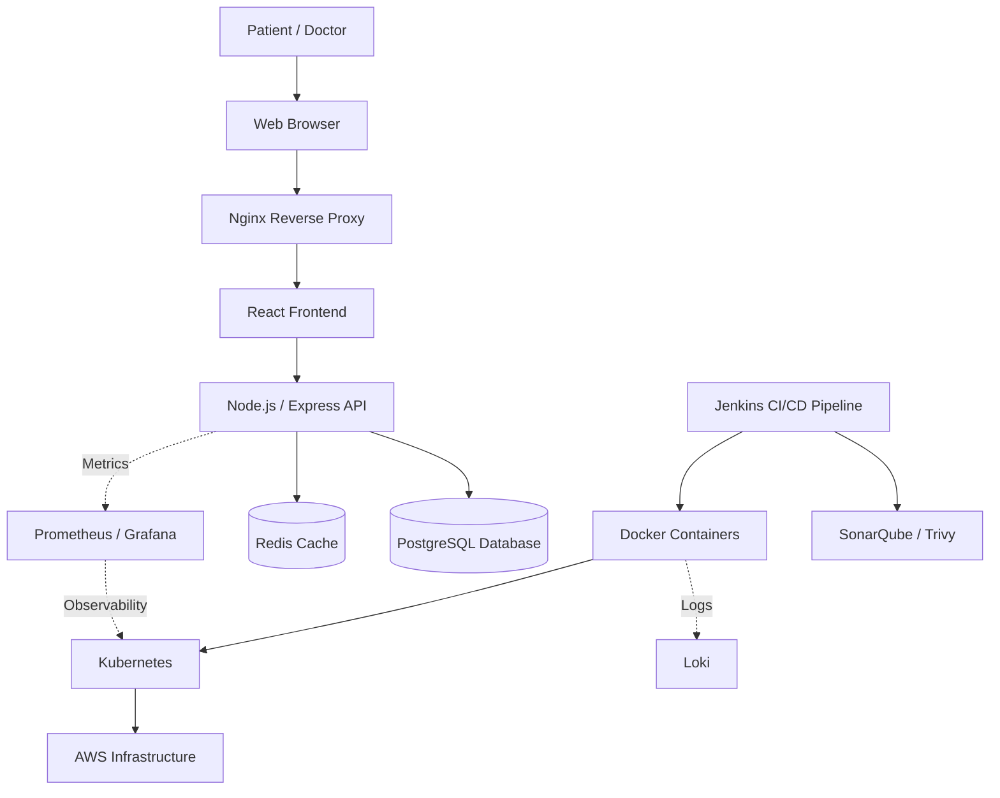

# Software Architecture – Scalable Telemedicine Platform

## 1. Overview

The Scalable Telemedicine Platform is designed to provide patients and doctors with a reliable platform for managing medical appointments remotely.

The proposed architecture separates the user interface, application logic, data storage, and infrastructure management to improve maintainability, scalability, and deployment.

This document describes the proposed architecture for the initial Minimum Viable Product (MVP).

## 2. Architecture Style

The proposed application will follow a **Layered Architecture** with a client-server model.

The main layers are:

- **Presentation Layer:** React provides the user interface.
- **Application Layer:** Node.js and Express handle API requests and business logic.
- **Data Layer:** PostgreSQL stores persistent application data, while Redis can be used for caching or other appropriate temporary data.
- **Infrastructure Layer:** Docker, Kubernetes, Nginx, and AWS support containerization, traffic routing, deployment, and scaling.

The initial application is planned as a modular backend. A microservices architecture is not assumed for the MVP.

## 3. High-Level Architecture Diagram

## 4. Component Responsibilities

| Component | Responsibility |
|---|---|
| React | Provides the user interface for patients and doctors. |
| Node.js / Express | Implements API endpoints, validation, authentication, and appointment business logic. |
| PostgreSQL | Stores users, doctor profiles, and appointment records. |
| Redis | Supports caching or other suitable temporary data when required. |
| Nginx | Acts as a reverse proxy and routes incoming requests. |
| Docker | Packages application components into containers. |
| Kubernetes | Orchestrates containers and supports scaling and recovery. |
| Jenkins | Automates the planned CI/CD pipeline. |
| Terraform | Defines and provisions infrastructure as code. |
| AWS | Provides the planned cloud hosting environment. |
| Prometheus | Collects application and infrastructure metrics. |
| Grafana | Visualizes metrics and monitoring dashboards. |
| Loki | Collects and queries application logs. |
| SonarQube | Analyzes code quality. |
| Trivy | Scans container images and supported project artifacts for security issues. |
| Ansible | Supports configuration management and automation where required. |

## 5. Main Request Flow

1. A patient or doctor opens the web application through a browser.
2. Nginx routes the request to the appropriate frontend or backend service.
3. React sends API requests to the Node.js / Express backend.
4. The backend validates the request and applies the relevant business rules.
5. The backend reads or updates persistent data in PostgreSQL.
6. Redis may be used when caching or temporary data storage is appropriate.
7. The backend returns a response to the frontend for display to the user.

## 6. Deployment and Monitoring

The planned deployment workflow will use Jenkins to automate build and testing stages, with SonarQube and Trivy integrated where appropriate.

Docker will package the application, while Kubernetes is planned to orchestrate container workloads. Terraform will manage supported infrastructure resources on AWS.

Prometheus, Grafana, and Loki will support monitoring, visualization, and log analysis.

The final deployment topology will depend on the selected hosting configuration and project implementation.

## 7. Design Considerations

- **Scalability:** Application components should support growth in workload where required.
- **Maintainability:** Separation of responsibilities makes components easier to modify and test.
- **Security:** Authentication, authorization, secure configuration, and input validation must be addressed during implementation.
- **Reliability:** Health checks, monitoring, and appropriate recovery mechanisms should be incorporated.
- **Observability:** Metrics and logs should help identify operational issues.
- **Cost Awareness:** Infrastructure choices should fit the project budget and educational scope.

## 8. Current Status

This document describes the proposed software architecture. The components, integrations, and deployment topology must be validated during implementation.

The diagram does not claim that the application has already been deployed or that all listed DevOps tools have been integrated.
