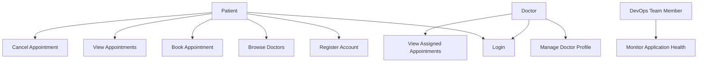

# Use Case Diagram – Scalable Telemedicine Platform

## 1. Overview

This document describes the main actors and their interactions with the proposed Scalable Telemedicine Platform.

The diagram represents the planned functionality of the initial Minimum Viable Product (MVP).

## 2. System Actors

- **Patient:** Registers, logs in, browses doctors, and manages appointments.
- **Doctor:** Logs in, manages basic professional profile information, and views assigned appointments.
- **DevOps Team Member:** Monitors application health and operational status.

## 3. Use Case Diagram

## 4. Use Case Descriptions

| ID | Use Case | Actor | Description |
|---|---|---|---|
| UC-01 | Register Account | Patient | Creates a new patient account. |
| UC-02 | Login | Patient, Doctor | Authenticates a registered user. |
| UC-03 | Browse Doctors | Patient | Views available doctors and their basic information. |
| UC-04 | Book Appointment | Patient | Requests an appointment with a selected doctor. |
| UC-05 | View Appointments | Patient | Views existing appointments. |
| UC-06 | Cancel Appointment | Patient | Cancels an eligible appointment. |
| UC-07 | Manage Doctor Profile | Doctor | Views or updates basic professional profile information. |
| UC-08 | View Assigned Appointments | Doctor | Views appointments assigned to the doctor. |
| UC-09 | Monitor Application Health | DevOps Team Member | Checks application health and monitoring information. |

## 5. Notes

- This diagram represents the proposed MVP functionality and does not indicate that these features have already been implemented.
- Detailed requirements are documented in `REQUIREMENTS.md`.
- The use cases will be validated against the final application scope and implementation.
